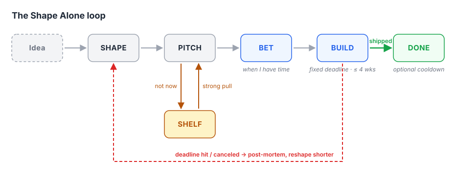
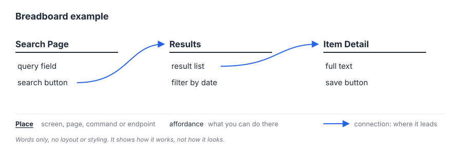
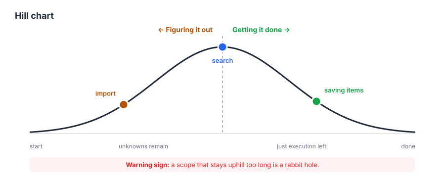

# Shape Alone

*A solo adaptation of Shape Up. I shape ideas into rough pitches, bet on one when I have time, build it with a fixed deadline and no extensions, and if it isn't done, it goes back to the drawing board.*

---

## Contents

1. [Why](#why)
2. [The Method in Brief](#the-method-in-brief)
3. [Core Rules](#core-rules)
4. [Shaping](#shaping)
5. [Pitching](#pitching)
6. [The Shelf](#the-shelf)
7. [Betting](#betting)
8. [Building](#building)
9. [The Circuit Breaker](#the-circuit-breaker)
10. [Cooldown](#cooldown)
11. [Documentation](#documentation)
12. [File Structure](#file-structure)
13. [Appendix](#appendix)
14. [A Note on AI Use](#a-note-on-ai-use)

---

## Why

Throughout my undergrad, I kept starting ambitious solo projects with no real timeline and no goal beyond "an app that does X." I tried Agile and I tried Kanban, and neither stuck. Used on its own, Kanban broke down when the product wasn't fully designed up front, which left room for bloat and rabbit holes. Agile felt like a constant sprint toward a finish line that never came.

What I learned is that to actually ship something, I need three things:

- a clear sense of what the project is worth to me
- a quick way to pitch ideas to myself, so I can brainstorm freely and bet on the good ones when I have time
- a firm time budget, because a project that drags on gets forgotten

While researching, I found Shape Up, the method created by Basecamp. It's built around the problem I kept hitting: work expands to fill whatever time you give it. Instead of asking "how long will this take?", Shape Up asks "how much time is this worth?" It calls that the project's *appetite*. Teams get a fixed cycle with high autonomy and no extensions. If the work isn't done when the cycle ends, it doesn't roll into the next one. The team pulls the plug, reshapes the project, and works out why it failed: a rabbit hole, too large a scope, or an impossible task.

That discipline matters even more when working alone. Solo, it's easy to overestimate what I can do and let the scope creep. No matter how hard I try to wear different hats, I'll eventually fall into that trap. Hard deadlines with no extensions are my guard against it. If I miss one, the project goes back to the drawing board instead of dragging on.

Shape Up also keeps early planning loose, which suits how I work. Ideas are shaped around how they work, not how they look, so I'm never locked into a design I made months ago, and going off a design doesn't kill a project I still believe in. Rejected pitches don't pile up in a backlog. I can shelve them and come back when I feel a strong pull. That flexibility lets my projects grow with me as a developer. An idea I shelved as a beginner can be reshaped later with everything I've learned since, instead of being stuck with the plan I made back then.

---

## The Method in Brief

There are no fixed cycles. Every project starts as an idea that I shape into a rough pitch: the problem, how much time it's worth (its *appetite*), and a sketch of how it works. Pitches I'm not ready for go on the shelf.

When I have time, I bet on one pitch, and only one at a time. Its appetite becomes a hard deadline, written down before I start. I lean toward short timelines, and nothing should go past 4 weeks.

Then I build. If it ships by the deadline, it's done, and I can take a cooldown to clean up and rest if I need one. If it doesn't, the circuit breaker trips. The project gets no extra time, goes back to shaping, and I work out why it didn't fit.



---

## Core Rules

1. **One bet at a time.** I never build two projects at once.
2. **The deadline never moves.** No extensions, for any reason.
3. **Lean short. Soft ceiling of 4 weeks.** If a pitch needs more than 4 weeks, that's a sign it should be split into smaller pitches.
4. **If life gets busy, the bet is canceled.** No pausing. A canceled bet counts as a circuit-breaker trip: it goes back to shaping, and the next version should have a shorter timeline.
5. **Shape mechanics, not looks.** Pitches describe how something works, not how it looks.
6. **Cooldown is optional.** I take one when I need it, not by default.
7. **Not documented, not shipped.** A project isn't done until its README and ship note are written. Documentation is part of the bet and has to fit inside the deadline.

---

## Shaping

Shaping turns a raw idea into something I could build within a fixed amount of time. A shaped idea is:

- **Rough.** It leaves room for decisions while building. Nothing is pixel-perfect or final.
- **Solved.** The core mechanics and logic are worked out. I know *how* it works, even if I don't know what it looks like.
- **Bounded.** It's clear what's in and what's out.

### What shaping produces

**Breadboards.** These are text-only flows that describe the mechanics without any visual design. A breadboard has three parts:

- **Places:** screens, pages, commands, or endpoints the user can be in or call
- **Affordances:** things the user can do there (buttons, fields, flags, inputs)
- **Connections:** where each affordance leads



**Fat-marker sketches.** These are rough drawings made with a thick pen, or the digital equivalent, so that detail is impossible. I only use them when layout actually matters to the mechanics, such as a dashboard where the arrangement *is* the feature. Otherwise, the breadboard is enough.

### When to stop shaping

I stop shaping when I can answer yes to all four:

- Can I explain how it works from start to finish?
- Do I know the riskiest part, and do I have a plan for it? If I'm not sure it's even possible, I run a [spike](#spikes) first.
- Do I know what I'm deliberately leaving out?
- Does it fit within an appetite of 4 weeks or less?

If I can't answer yes to the last one, I don't keep shaping the same idea. I split it into smaller pitches.

---

## Pitching

A pitch is the shaped idea written down so I can make a bet on it, now or months from now. Every pitch has five parts:

1. **Problem:** what's wrong or missing, and why I care. If I can't explain why it matters to me, it's not worth a bet.
2. **Appetite:** how much time this is worth, not how long it will take. It's set here, in the pitch, and becomes the deadline when I bet. Changing the appetite means reshaping the pitch, not just editing the number.
3. **Solution:** the breadboard and any fat-marker sketches. Enough to understand the mechanics, no more.
4. **Rabbit holes:** the risky or unknown parts I've spotted, and how I'll avoid getting stuck in them (a simplification, a cut, or a decision made ahead of time).
5. **No-gos:** what is explicitly out of scope for this bet.

Every pitch also has a **Documentation** field listing what this project needs beyond the README and ship note (see [Documentation](#documentation)).

Pitches are short. If a pitch runs past a page or two, it's either over-designed or too big for one bet.

A blank template is in [Appendix A](#a-pitch-template).

---

## The Shelf

The shelf is where pitches go when I'm not ready to bet on them. It's not a backlog:

- **Nothing on the shelf is owed.** I never have to read or review a shelved pitch.
- **Nothing on the shelf is ranked.** No ordering, no grooming, no priorities.
- **Shelved pitches don't expire.** They stay until I delete them or bet on them.

### Coming back to a pitch

I pull a pitch off the shelf when I feel a strong pull toward it: I keep thinking about the problem, I run into it in real life, or I've learned something that makes the solution easier. Before betting on a shelved pitch, I reread it and reshape it if needed. My skills and priorities may have changed since I wrote it, and the pitch should change with them.

---

## Betting

A bet is a commitment to build one pitch within its appetite.

### When I bet

There are no scheduled betting days. I bet when I have time to commit to the full appetite. Before betting, I check:

- Do I actually have the time between now and the deadline? If something big is coming up (exams, a move, a job search), I either choose a shorter pitch or don't bet.
- Is the `active/` folder empty? (Rule 1)

### Choosing between pitches

When more than one pitch is ready, I choose based on:

- **Pull:** which one I want to build most right now
- **Fit:** which appetite fits the time I actually have
- **Value:** which one I'll actually use once it's done

### Placing the bet

1. Move the pitch into `active/`.
2. Write the start date and the deadline (start date + appetite) at the top of the pitch.
3. Create a fresh Kanban board for the bet.
4. Start building.

From this moment, the deadline never moves.

---

## Building

### Breaking down the work

A pitch describes *what* to build. Breaking down the work turns it into tasks I can actually code.

**1. Get oriented on day one.** I reread the pitch and write down the tasks I can see. I don't try to list everything, because most tasks are only discovered once I start coding. Then I pick one small piece of the core mechanic and get it working from start to finish, with real input in and real output out, before building anything around it.

**2. Let scopes emerge.** After a few days of real work, I group my tasks by what they touch together. Those groups are my **scopes**: chunks of the project that can be finished on their own and that make sense as a unit (for example, "search," "saving items," "import"). Scopes are named after parts of the product, not after technical layers like "frontend" or "database." Scopes found through real work are more accurate than scopes guessed from the pitch.

**3. One exception: the docs scope starts on day one.** It's tracked like any other scope, and it's the one scope that can never be cut.

**4. Start with the riskiest scope.** The scope with the most unknowns goes first, so that if something is going to break the bet, I find out in the first week rather than the last.

Scopes are allowed to change as I build. Discovering new scopes and tasks is normal. They show me what the work really is.

### The Kanban board

Kanban failed me when it was my whole process. Nothing bounded the work, so the board kept growing. In Shape Alone, the pitch bounds the scope and the deadline bounds the time, so the board does what it's good at: keeping me organized day to day.

**Tool:** any board works, such as GitHub Projects, a Markdown checklist, or a board app. The rules matter, not the tool.

**Columns:** To Do → Doing → Done → Cut

**Card size:** one card is half a day of work or less. If a card is bigger, I split it. If I can't split it because I don't know what's inside it yet, that's an unknown, and the scope it belongs to is still uphill.

**Rules:**

1. **One board per bet.** It's created when I bet and archived when the bet ends, whether it shipped or tripped. Nothing carries over to the next bet, because a board that carries over is a backlog.
2. **Only tasks go on the board.** Pitches and ideas live in their folders, never on the board.
3. **Every card belongs to a scope.** I use a label (or a row) per scope so the board lines up with the hill chart.
4. **Nice-to-haves are marked.** I prefix them with `~`. They're the first cards to move to Cut.
5. **Cut is a real column.** Moving a card there records the cut, which feeds the Cuts list in the ship note.
6. **Limit Doing.** No more than one or two cards in Doing at a time. Solo, anything more is pretending to multitask.

The board doesn't replace the hill chart. The board shows **what's left to do**. The hill chart shows **what I'm still unsure about**. A scope can have most of its cards in Done and still be uphill if the last card is a mystery.

### Each work session

Since I only build when I have time, sessions can be days apart. A short routine at the start and end of each one keeps me from losing my place.

**Start of a session (about 5 minutes):**
1. Read the "next step" note I left last time.
2. Check the hill chart. Has any scope been uphill too long?
3. Pull one or two cards into Doing.

**End of a session (about 5 minutes):**
1. Move finished cards to Done, and add any new tasks I discovered as cards.
2. Update each scope's position on the hill chart.
3. If I finished a scope, add its section to the README while it's fresh.
4. Write a one-line "next step" note at the top of the active pitch, so the next session starts in seconds instead of minutes.

### Hill chart

Each scope has a position on a hill:



- **Uphill (figuring it out):** I still have unknowns. I'm not sure how this will work yet.
- **Downhill (getting it done):** all the unknowns are solved, and what's left is execution.

I update positions at the start and end of every work session (see [Each work session](#each-work-session)). The point is to catch trouble early. **A scope that stays uphill for too long is a rabbit hole.**

### Spikes

A **spike** is a small experiment that answers one question. Whenever something is unknown, whether a scope is stuck uphill or I'm not sure an idea is even possible, I don't guess and I don't build the whole feature to find out. I run a spike.

Every spike is:

1. **Small.** Half a day or less, the same size as a card. If it can't be answered in half a day, the question is too big, so I split it.
2. **About one question.** "Can this library parse these files fast enough?", not "build the parser."
3. **Disposable.** The answer is what I keep, not the code. Spike code doesn't get copied into the project.

A spike goes on the board as a card labeled with its scope. When it's done, I write the answer in one line on the card and move the scope on the hill chart.

**If the answer is no:**
- If the scope is a nice-to-have, cut it.
- If the scope is core, try to simplify it with one more spike.
- If it's core and can't be simplified, the pitch rested on something impossible, so the circuit breaker trips.

**Spikes during shaping:** if a pitch depends on something I'm unsure is possible, I run a spike *before* betting. That way I find an impossible task in half a day instead of halfway through a bet.

### Cutting scope

The deadline is fixed, so the scope is what changes. When time runs short:

- Compare against the baseline (what exists today without this project), not against the ideal version.
- Cut nice-to-haves without guilt. Cutting scope is the method working as intended, not failure.
- Never cut the docs scope. Cut a feature first. A smaller project I can understand later is worth more than a bigger one I can't.
- Write down what I cut and why. Cut items go in the ship note and can become new pitches.

---

## The Circuit Breaker

When the deadline arrives, one of two things is true:

- **It shipped.** It's usable, does what the pitch promised (minus anything I deliberately cut), and its README and ship note are written. It moves to `done/`. Working code with no documentation counts as **not shipped**.
- **It didn't ship, or the bet was canceled.** The circuit breaker trips. The project gets no extension and no "just one more weekend."

### After a trip

1. Stop building.
2. Write a short post-mortem (template in [Appendix B](#b-post-mortem-template)) that answers one question: **why didn't it fit?**
   - **Rabbit hole:** I got stuck on something I didn't see or didn't avoid.
   - **Scope too big:** the pitch was more than the appetite could hold.
   - **Impossible task:** something didn't work the way I assumed.
   - **Life got busy:** the bet was canceled (Rule 4).
3. Move the pitch to `shaping/` to be reshaped, or to `shelf/` if I'm not ready to reshape it yet.
4. If I reshape it, the new pitch must address the cause, and it should have a shorter appetite than the original.

A tripped circuit breaker is information, not failure. The post-mortem is what makes the next pitch better.

---

## Cooldown

Cooldown is optional time after a bet ends, whether it shipped or tripped. There's no set length. I take one when I need it. Good uses:

- Fixing bugs in what I just shipped
- Cleaning up code and polishing documentation (the required docs are already written by this point)
- Shaping new pitches or reshaping a tripped one
- Browsing the shelf, if something is pulling at me
- Resting

The only rule: **no building new projects during cooldown.** If I want to build, I place a bet.

---

## Documentation

### Why it's required

When a bet ships, I may not touch that project again for months. Life gets busy, or I simply stop needing it for a while. When I come back, everything I knew while building it (how to run it, why it's built the way it is, what's half-finished, where the sharp edges are) will be gone. Without documentation, coming back means relearning my own code from scratch, and a project that's too painful to return to is effectively dead.

Documentation is a message to future me, who will have forgotten everything. That's why it's a core rule (Rule 7) and not a cooldown chore: cooldown is optional, and the moment right after shipping is when I remember the most.

### The cold-start test

The documentation is good enough when it passes this test:

> **Six months from now, with no memory of this project, can I install it, run it, use it, and make a change to it using only the README?**

If the answer is no, the docs scope isn't over the hill yet.

### What gets written, and when

| Stage | Document | Required? |
|---|---|---|
| Shaping | Pitch (problem, appetite, solution, rabbit holes, no-gos) | Yes |
| Betting | Start date and deadline added to the pitch | Yes |
| Building | Scopes and hill positions, updated each session | Yes |
| Building | Cuts list: what I cut and why | Yes |
| Shipping | **README** in the project repo | **Yes, can't be cut** |
| Shipping | **Ship note** at the bottom of the pitch | **Yes, can't be cut** |
| Circuit breaker | Post-mortem | Yes, if it tripped |
| Cooldown | Extra polish (diagrams, deeper docs) | Optional |

### How to state the docs a project needs

Different projects need different amounts of documentation. A one-week script needs less than a four-week app. I decide what a project needs **in the pitch, before betting**, not at the end when I'm out of time:

1. **Start from the baseline.** Every project gets a README and a ship note. That's never negotiable.
2. **Add anything project-specific to the pitch's Documentation field.** Ask: what would future me need that the baseline doesn't cover? Examples:
   - A server or service → setup, configuration, and how to recover it if it breaks
   - A tool with commands or an API → a reference for every command or endpoint
   - Anything with stored data → where the data lives, its format, and how to back it up
   - A tricky design choice → a short note on *why* it was done this way
3. **Write each item as something that's either done or not.** For example, "README has install steps that work on a fresh machine," not "document the install." That way the docs scope can be judged on the hill chart like any other scope.
4. **Budget for it.** Docs come out of the appetite, not after it. If the project's docs needs are large, the appetite or the scope has to account for that.

### Write as I go

The docs scope isn't saved for the last day. When I finish a scope, I add its section to the README while it's fresh. The final day is for checking against the cold-start test, not for writing everything from memory.

---

## File Structure

Everything lives in Markdown files in one folder (or repo):

```
shape-alone/
├── shaping/        # ideas being shaped, and tripped bets being reshaped
├── pitches/        # shaped and ready to bet on
├── shelf/          # not now, maybe later
├── active/         # the current bet (never more than one file)
├── done/           # shipped bets
└── postmortems/    # one file per tripped bet
```

Each pitch is a single `.md` file named after the project, such as `pitches/offline-search.md`. The file moves between folders as its status changes, so the folder *is* the status.

---

## Appendix

### A. Pitch Template

```markdown
# [Project Name]

**Status:** shaping | pitch | shelf | active | done
**Appetite:** [X] weeks (max 4)
**Start date:** [set when bet]
**Deadline:** [start date + appetite]
**Next step:** [one line, updated at the end of each session]

## Problem
What's wrong or missing, and why I care.

## Appetite
How much time this is worth and why.

## Solution
Breadboard:

[Place]
  - affordance → [Next Place]

Fat-marker sketches (only if layout matters):

## Rabbit Holes
- Risk: ...
  Plan: ...

## No-Gos
- ...

## Documentation
Baseline: README + ship note (always).
Project-specific (each one is done or not done):
- [ ] ...

## Scopes (filled in when building)
| Scope | Hill position |
|-------|---------------|
| docs  | uphill / top / downhill / done |
|       | uphill / top / downhill / done |

## Cuts (filled in when building)
- [what I cut]: [why]

## Ship Note (filled in when shipped)
- **Shipped:** [date]
- **What shipped:** ...
- **What got cut:** see Cuts
- **Was the appetite right?** too short / about right / too generous
- **If I come back to this, start here:** ...
```

### B. Post-Mortem Template

```markdown
# Post-Mortem: [Project Name]

**Appetite:** [X] weeks
**Bet placed:** [date]
**Ended:** [date]
**Outcome:** deadline hit | canceled

## What got done
Which scopes made it over the hill.

## Why it didn't fit
- [ ] Rabbit hole: ...
- [ ] Scope too big: ...
- [ ] Impossible task: ...
- [ ] Life got busy: ...

## What I'd change in the pitch

## Next step
- [ ] Reshape with a shorter appetite (new appetite: __ weeks)
- [ ] Shelve
- [ ] Drop
```

### C. README Template

```markdown
# [Project Name]

One or two sentences: what this is and what problem it solves.

## Status
Shipped [date] · Built with Shape Alone · Appetite: [X] weeks
Known limitations: ...

## Install
Exact steps from a fresh machine, including versions and dependencies.

## Run
The command(s) to start it, and what you should see when it works.

## Use
The main things it does, with examples.

## How It Works
A short overview of the structure: main parts, where data lives, how they connect.

## Why It's Built This Way
Key decisions and the reasons for them.

## Notes for Future Me
Sharp edges, half-finished bits, things I'd do next, and anything that confused me while building.
```

### D. Worked Example

*To be written after my first bet: one real project taken through shaping, pitching, betting, building, and either shipping or tripping the circuit breaker.*

---

## A Note on AI Use

I used an AI assistant (Claude, by Anthropic) to help write and design this document.

**What's mine:** the idea for the method, the original "Why" section, and the decisions that define it, including no fixed cycles, one bet at a time, a 4-week soft ceiling, canceling bets when life gets busy, optional cooldown, and making documentation a requirement.

**What the AI helped with:**
- Editing my original writing for clarity and grammar
- Suggesting the document's structure and section order
- Asking me questions to pin down how the method should work, then drafting sections from my answers
- Proposing some supporting details, such as the shaping checklist, the folder structure, and the templates, which I'm refining as I use the method
- Creating the diagrams

The method itself is adapted from [Shape Up](https://basecamp.com/shapeup) by Ryan Singer at Basecamp.
